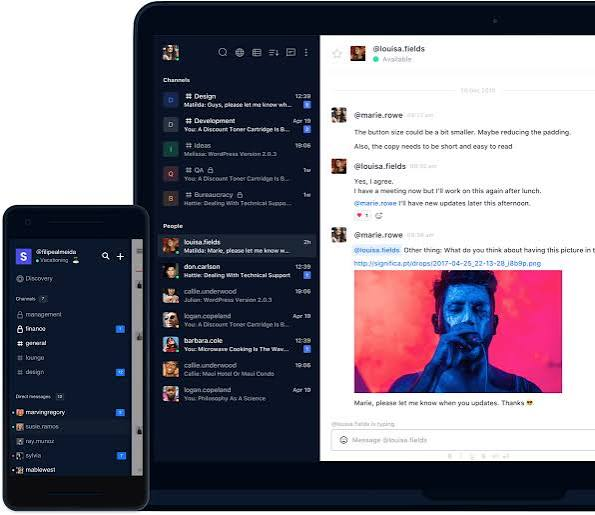

[](https://github.com/rocket-chat-cloud/rocket-chat/releases/)

# Rocket.Chat Secure Collaboration and Messaging Platform

Rocket.Chat is an open-source collaboration platform for team messaging, voice calls, video meetings, screen sharing, file exchange, live chat, and governed automation.

It can be deployed on infrastructure controlled by an organization and supports communication across teams, departments, partners, and external communities.

## Project Snapshot

| Property | Value |
| --- | --- |
| Product | Rocket.Chat |
| Current release | 9.0.0 |
| Main technologies | JavaScript, TypeScript, Node.js, React, MongoDB |
| Communication model | Channels, direct messages, discussions, calls, and integrations |
| Deployment model | Self-hosted, private cloud, or isolated infrastructure |
| License | MIT for the community codebase, with separate enterprise components |
| Main repository | Rocket.Chat monorepo |
| Configuration source | [app.json](./app.json) |



## Core Communication

Rocket.Chat provides a unified workspace for real-time team communication.

- Public and private channels
- One-to-one conversations
- Group discussions
- Threads and replies
- Message editing
- Message deletion
- Mentions and notifications
- Reactions and emojis
- Markdown formatting
- Code blocks
- Link previews
- Embedded media
- File uploads
- Starred and pinned messages
- Full-text search
- Regular expression search
- Slash commands

The feature inventory is summarized in [FEATURES.md](./FEATURES.md).

## Voice, Video, and Screen Sharing

The platform supports communication beyond text messages.

Available collaboration capabilities include:

- Audio calls
- Video conferencing
- Screen sharing
- Live chat
- Mobile notifications
- Desktop notifications
- Missed-message email notifications
- Custom notification gateways
- Service integrations for real-time communication

The exact availability of communication features depends on the deployed version, workspace configuration, and enabled services.

## Channels and Workspace Organization

Rocket.Chat organizes conversations into rooms that can be public, private, direct, or discussion-based.

Teams can use channels to separate projects, departments, support queues, incidents, customer conversations, and internal operations.

Messages can be:

- Edited after sending
- Marked as important
- Pinned for the whole room
- Starred for personal access
- Searched by text
- Filtered by room or participant
- Connected to external integrations
- Shared with files and rich media

## Authentication and Identity

Rocket.Chat supports multiple authentication and identity options.

The repository feature list includes:

- OAuth providers
- SAML
- LDAP
- CAS
- Social sign-in providers
- Role-based permissions
- Workspace-specific access rules
- Custom identity integrations

Authentication features can vary by plan and release. Review the current release requirements before upgrading a production workspace.

## Integrations and Automation

Rocket.Chat can be extended through integrations, webhooks, APIs, apps, and automation services.

The project includes support for:

- Incoming webhooks
- Outgoing webhooks
- REST API access
- Hubot integrations
- Data import tools
- Slack import workflows
- Slack bridge functionality
- Marketplace applications
- Custom workspace automation
- Slash commands

The repository is organized as a monorepo with shared packages, applications, and enterprise components.

## File Sharing and Rich Media

Users can exchange files and media directly inside conversations.

Supported workflows include:

- Drag-and-drop uploads
- File-system uploads
- Object storage integrations
- AWS-backed storage
- CDN-backed delivery
- Embedded video
- Link previews
- Rich message formatting
- Emoji reactions
- Mathematical text formatting

Storage behavior depends on the selected deployment and configured file backend.

## Search and Message History

Rocket.Chat provides tools for finding information inside active workspaces.

Search capabilities include:

- Full-text search
- Regular expression search
- Room-based filtering
- User and message references
- Starred-message access
- Pinned-message access
- Mention history
- Conversation history

Search settings and retention behavior depend on workspace configuration.

## Mobile and Native Clients

Rocket.Chat supports access from desktop browsers, mobile applications, and native client projects.

The workspace can be used across:

- Linux
- Windows
- macOS
- Android
- iOS
- Mobile browsers
- Desktop browsers

Client behavior depends on the server version and the compatibility of the selected client.

## Deployment Models

Rocket.Chat is designed for organizations that require control over their communication infrastructure.

Possible deployment models include:

- Self-hosted servers
- Private cloud environments
- Containerized deployments
- Air-gapped environments
- Development workspaces
- Testing environments
- Enterprise installations
- Multi-service infrastructure

A local deployment configuration is represented in [docker-compose-local.yml](./docker-compose-local.yml).

The FIPS-oriented service configuration is represented in [docker-compose-ci.fips.yml](./docker-compose-ci.fips.yml).

## Service Architecture

The current repository contains a modular service layout.

The local deployment configuration references services for:

- Core Rocket.Chat operations
- Authorization
- Account management
- User presence
- DDP streaming
- Queue workers
- Omnichannel transcripts
- Federation services
- NATS-based communication
- MongoDB-backed data storage
- Traefik routing

The architecture is intended to support independent service development and deployment.

## Workspace Configuration

The application metadata in [app.json](./app.json) describes the project name, repository identity, website, keywords, deployment variables, and service add-ons.

The editor workspace layout is described by [Rocket.Chat.sublime-project](./Rocket.Chat.sublime-project).

That workspace separates the monorepo into:

- Root files
- The main Rocket.Chat application
- Shared packages
- Enterprise applications
- Enterprise packages

## Development Tasks

Task relationships and build outputs are declared in [turbo.json](./turbo.json).

The task graph includes:

- Build tasks
- Preview builds
- Unit tests
- Storybook tests
- Linting
- Type checking
- Development tasks
- Distribution tasks
- Meteor-specific builds

The project uses task dependencies to coordinate work across applications and packages.

## Local Development Configuration

The repository includes development configurations for monitoring and infrastructure services.

Examples include:

- [development/agent.yml](./development/agent.yml)
- [development/collector.config.yml](./development/collector.config.yml)
- [development/docker-compose-monitoring.yml](./development/docker-compose-monitoring.yml)
- [development/grafana-datasources.yml](./development/grafana-datasources.yml)
- [development/prometheus.yml](./development/prometheus.yml)
- [development/tempo.yml](./development/tempo.yml)

These files support local observability and service-level development workflows.

## Test and Maintenance Scripts

The repository contains focused scripts for maintenance and validation.

Documentation link checks are covered by [scripts/check-docs-links.test.mjs](./scripts/check-docs-links.test.mjs).

Meteor cache handling is implemented in [scripts/meteor-cache.sh](./scripts/meteor-cache.sh), with related tests in [scripts/meteor-cache.test.mjs](./scripts/meteor-cache.test.mjs).

Raw layout validation is handled by [scripts/scan-raw-layout.mjs](./scripts/scan-raw-layout.mjs).

The repository also includes [scripts/fossify.ts](./scripts/fossify.ts) for source maintenance workflows.

## Emoji Fixture Generation

The message parser uses a committed emoji fixture for coverage testing.

The purpose and regeneration process are documented in [scripts/emoji/README.md](./scripts/emoji/README.md).

After updating the emoji data dependency, the fixture can be regenerated with:

```bash
node scripts/emoji/generateEmojiFixture.mjs
```

The generator is located at [scripts/emoji/generateEmojiFixture.mjs](./scripts/emoji/generateEmojiFixture.mjs).

## Federation and External Communication

Rocket.Chat supports communication between organizational systems through federation and bridge services.

The platform may connect to:

- Matrix networks
- XMPP systems
- External collaboration platforms
- Webhook endpoints
- Custom applications
- REST API clients
- Internal automation tools

Federation settings should be evaluated carefully because they affect identity, message routing, trust boundaries, and data visibility.

## Security and Compliance

Security controls are applied through several layers:

- Authentication providers
- Role-based permissions
- Workspace policies
- Access restrictions
- Two-factor authentication
- Message validation
- File handling
- API authorization
- Federation checks
- Audit and retention controls
- Dependency updates

The current 9.0.0 release includes authentication changes, security fixes, API restrictions, and federation-related updates.

The LDAP, SAML, and custom OAuth availability may depend on the selected subscription plan.

## Release 9.0.0 Notes

The 9.0.0 release introduces changes across communication, administration, APIs, storage, and authentication.

Highlighted changes include:

- Native video conferencing powered by LiveKit
- Native XMPP federation support
- New governed access controls
- AI search filters
- Updated user profiles
- New UiKit blocks and interface elements
- Official JavaScript DDP SDK status
- Updated REST API response behavior
- Node.js 24.22.1 in official Docker images
- MongoDB 8.0 support
- New message parsing limits
- Multiple labeled phone numbers
- Removal of legacy federation and Matrix Bridge components

## Administration

Workspace administrators can manage:

- Users and roles
- Authentication methods
- Channels and teams
- Presence and user status
- Omnichannel settings
- File storage
- Notifications
- Federation
- Apps and integrations
- API access
- Data retention
- Compliance controls
- Workspace security

New workspaces may require explicit activation of optional modules such as Omnichannel.

## Data and Storage

Rocket.Chat uses MongoDB for workspace data and supports configurable storage backends for uploaded files.

Storage design should account for:

- Database backups
- File retention
- Message retention
- Object storage
- CDN configuration
- Access controls
- Encryption
- Disaster recovery
- Search indexing
- Workspace migration

The repository license and component boundaries are documented in [LICENSE](./LICENSE).

## LDAP Development Data

Development LDAP fixtures are included in [development/ldap/02-data.ldif](./development/ldap/02-data.ldif).

These fixtures are intended for development or testing workflows and should not be treated as production identity data.

## Contributing

Contributions should follow the repository's development and review conventions.

Before submitting changes:

- Keep the scope focused
- Preserve existing service boundaries
- Update tests for behavior changes
- Run relevant validation tasks
- Review authentication implications
- Avoid committing generated output
- Document breaking API changes
- Check dependency and license requirements
- Review changes affecting federation or file storage

## Project Structure

| Path | Purpose |
| --- | --- |
| `app.json` | Application and deployment metadata |
| `development/` | Local infrastructure and monitoring configuration |
| `scripts/` | Maintenance, validation, and generation utilities |
| `scripts/emoji/` | Emoji fixture documentation and generation |
| `docker-compose-local.yml` | Local multi-service deployment |
| `docker-compose-ci.fips.yml` | FIPS-oriented CI service overrides |
| `turbo.json` | Monorepo task graph |
| `FEATURES.md` | Feature inventory |
| `LICENSE` | License and component terms |
| `Rocket.Chat.sublime-project` | Editor workspace layout |

## License

The community portions of Rocket.Chat are available under the MIT License.

Enterprise directories and third-party components may use separate license terms. Review [LICENSE](./LICENSE) before redistributing or modifying the complete repository.

.png)

## Related Search Terms

rocket chat, rocket chat open source, rocket chat community edition, rocket chat cloud, rocket chat web, rocketchat, rocket chat pricing, rocket chat docker, rocket chat live chat, rocket chat demo, rocket chat docs, rocket chat ios, rocket chat linux, rocket chat ubuntu, rocket chat kubernetes, rocket chat on premise, self host rocket chat, rocket chat matrix, rocket chat xmpp, rocket chat mongodb
